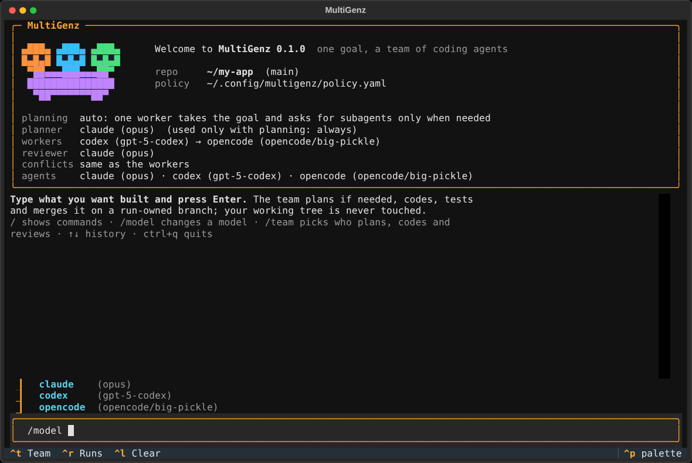
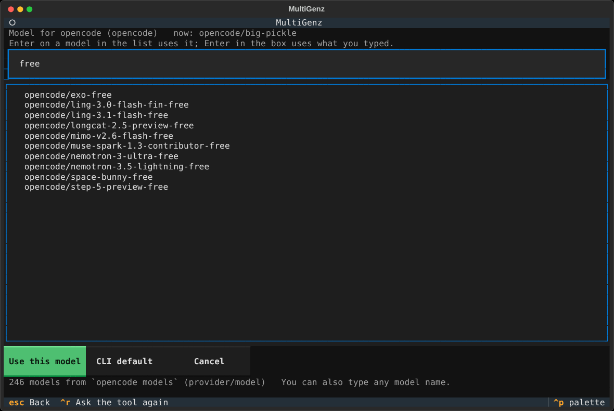

# MultiGenz

Local-first autonomous multi-agent software-development orchestrator. It drives the coding-agent CLIs you already use
(**Claude Code, opencode, Cline, OpenAI Codex, Hermes Agent**, experimentally Google Antigravity) plus LiteLLM providers for planning
and review text, each in its own sandbox and Git worktree, and integrates only independently tested work.

**Status:** implemented through milestones M1–M5 and verified by an automated suite (see [docs/TESTING.md](docs/TESTING.md)).
Read [What is and is not verified](#what-is-and-is-not-verified) before trusting it with real work.

## What it does
Accepts a development objective, obtains a validated task DAG from a planner agent (or a plan file), dispatches
independent tasks to isolated agents in separate Git worktrees, **independently** verifies every result (path ownership,
diff hygiene, credential scan, deterministic review, administrator-defined tests), integrates only verified work on a
run-owned branch, repairs within bounds, and reports honestly. It never pushes, deploys or touches your branches.

## Design principles
- Python 3.12+, Typer CLI, Textual TUI, Pydantic v2, asyncio, SQLite WAL, Git worktrees.
- The orchestrator — not any model — owns task state, policy, scheduling, Git integration and every success decision.
- Each agent runs in a restricted sandbox (fail closed; never silently unsandboxed). Worktrees alone are *not* isolation.
- Agent output, repository text and planner output are untrusted. Test commands come from host policy only.
- Autonomous work may update only `multigenz/run-<id>/…` branches. No push, deployment or protected-branch write exists.
- No success claim without independently verified tests and artifacts; costs that cannot be measured are reported as unknown.

## Install and first run
```bash
curl -fsSL https://try-menghong.github.io/multigenz/install | bash   # once the site is published (see below)
# or, from a clone of this repository:
MULTIGENZ_SOURCE=$PWD bash install.sh

multigenz agents presets      # supported agent CLIs, how well each is tested, which are installed
multigenz init                # writes ~/.config/multigenz/policy.yaml with the CLIs found on PATH
multigenz doctor              # sandbox, git, sqlite, agents, test profile
multigenz run "Add input validation with tests" --repo ./app
multigenz                     # or just this: the interactive home screen (below)
```
The installer needs Linux, git >= 2.38 and Python >= 3.12 (or `uv`, which can provide Python). It installs into
`~/.multigenz`, links `~/.local/bin/multigenz`, never uses sudo, and `bash install.sh --uninstall` removes it again.
It installs from `main` by default; set `MULTIGENZ_REF=<branch>` to install another branch. While the repository is
private, the installer uses your SSH key (`git@github.com:...`) when https needs credentials.

### The interactive home screen
Run `multigenz` with no arguments in a terminal (from inside your repository) and you get the home screen: the
MultiGenz pet — three little heads on one body, one team of agents — the team with each agent's model, and a prompt.
Type what you want built and press Enter: a run starts in that repository on its own `multigenz/run-<id>/…` branch and
its live dashboard opens (Esc comes back). Type `/` for commands; Tab completes, ↑/↓ recall earlier lines.



| Command | What it does |
|---|---|
| `/model [agent] [model\|default]` | change the model an agent uses (a picker when no model is given) |
| `/team` | choose who plans, codes, reviews and resolves conflicts (and each agent's model: `m`) |
| `/agents` | the agents, their models, and whether they work on this machine |
| `/providers` | API providers: store a key, fetch the model list, add an agent from a model |
| `/planning always\|auto\|never` | how much planning a goal gets |
| `/repo PATH` · `/runs` · `/doctor` · `/init` · `/help` · `/clear` · `/quit` | |

### Choosing models
Every agent can be pointed at a model: Claude Code (`opus`, `sonnet`, … or a full model name), Codex (e.g.
`gpt-5-codex`), opencode (`provider/model`), Cline, Hermes, and API-provider agents. The choices are asked from the tool
itself where it can list them (Claude Code's aliases from its `--help`, `opencode models`, a provider's `/models`); for
the others you type the name. Before saving, MultiGenz checks that the installed CLI's `--help` really shows a model
option (`--model`); if it does not, the change is refused rather than silently running the default model.
```bash
multigenz agents model claude opus           # also: --list to see the choices, --clear for the CLI's default
multigenz agents model opencode opencode/big-pickle
```
In the TUI: `/model`, or `m` on an agent in the Team screen.



`site/` is the download page; `.github/workflows/pages.yml` publishes it with `install.sh` served at `/install` once
GitHub Pages is enabled (Settings → Pages → Source: GitHub Actions) and the work is on `main`.

### Agents
| Preset | Runs | Tested | Notes |
|---|---|---|---|
| `claude` | `claude --print --permission-mode acceptEdits` | real model runs (Claude Pro login, userns sandbox) | may run pytest itself; Pro/Max: export `CLAUDE_CODE_OAUTH_TOKEN` from `claude setup-token` |
| `opencode` | `opencode run --auto` (prompt on stdin) | end to end in the sandbox against a local scripted model | uses opencode's own login files, mounted read-only |
| `cline` | `cline --yolo` / `cline --plan` | end to end in the sandbox against a local scripted model | uses `~/.cline/data/settings/providers.json` |
| `codex` | `codex exec --sandbox workspace-write` / `read-only` | end to end in the sandbox against a local scripted model | keeps its own bubblewrap sandbox inside MultiGenz's; uses `~/.codex/auth.json` |
| `hermes` | `hermes -z <prompt>` (one-shot) | end to end in the sandbox against a local scripted model | Hermes's own config, skills and plugins are mounted read-only |
| API model | `opencode` with a generated provider config (coding) or a direct API call (text only) | end to end in the sandbox against a local provider that checks the key | any OpenAI-compatible provider, Anthropic, Ollama; `multigenz providers` or TUI `/providers` |
| `agy` | `agy --print --mode accept-edits` | experimental: flags from `agy --help`, never executed here | check with `multigenz agents run` first |

Add one with `multigenz agents add <preset>`. Choose which agent plans (the orchestrating agent), which ones code,
review and resolve conflicts in the TUI (`/team`), or with `multigenz roles`; see
[docs/OPERATIONS.md](docs/OPERATIONS.md#roles-who-plans-codes-reviews-and-resolves-conflicts). To try your installed agents against their real providers (uses a little of
each plan): `scripts/smoke_agents.sh`. Any other CLI with a non-interactive mode can be configured by hand
(`agents.<name>.invocations`, see [docs/OPERATIONS.md](docs/OPERATIONS.md)); flags are always verified against the
binary's own `--help` before use.

## Commands (all implemented and covered by tests)
```text
multigenz init [--agent P] [--overwrite]   starter policy with the agent CLIs found on PATH
multigenz doctor                         environment, isolation backends, adapter capability detection
multigenz agents presets | add P         supported agent CLIs; add one to the policy (validated, backup kept)
multigenz agents enable | disable NAME   switch an agent on or off in the policy
multigenz agents model NAME [MODEL] [--list | --clear]   show or change the model an agent uses
multigenz roles [set ROLE A B | clear R]  who plans (orchestrating agent), codes, reviews, resolves conflicts
multigenz roles planning auto|always|never  auto: one agent takes the goal, subagents only when needed
multigenz providers presets | add | list | models NAME | use NAME MODEL [--as coder|text]
                                         API providers: store the key (0600), fetch model ids, make an agent
multigenz agents list | run              inspect adapters; run ONE sandboxed agent -> validated commit
multigenz plan "<goal>" [--out plan.json]   planner agent proposes a DAG; validated; nothing executed
multigenz run "<goal>" --repo R [--planning auto|always|never] [--plan-file plan.json] [--detach]
multigenz runs list | show | events | audit | logs | cancel | resume
multigenz  (no arguments, on a terminal)  interactive home: the pet, the team and its models, a prompt for goals,
                                         /commands (/model /team /agents /providers /planning /repo /runs /doctor)
multigenz tui [--team | --runs]          the same TUI, opened on the home, Team or run-list screen: history, live
                                         task states, redacted logs, cancel, doctor, roles, models, API providers
```
`Ctrl-C`/SIGTERM on `run` is a *resumable* interrupt (agents stopped, work preserved); `runs cancel` is terminal.
A run whose orchestrator was killed shows as *orphaned*; `runs resume` reconciles leases, OS processes, worktrees and
commits before continuing and never re-executes finished work.

## What is and is not verified
| Area | Evidence | Caveat |
|---|---|---|
| Planner → DAG → sandboxed tasks → validation → integration → report | 16 acceptance tests, E2E A/B/C (real FastAPI code, real pytest in the sandbox and again on the host) | those agents are **scripted stand-ins** |
| Real coding-agent CLIs inside the sandbox | Codex 0.162, opencode 1.19 and Cline 3.0 plan, code, validate and integrate end to end (`tests/e2e/test_cli_agents.py`), including one run where Cline plans and opencode codes | the model behind them is a **local scripted server**, not a real provider |
| Claude Code with a real model | several real runs by a user with a Claude Pro login (planning, repair after a failed attempt, integration) | not part of the automated suite (needs a login) |
| Codex | codex-cli 0.162.1 plans (`read-only`) and codes (`workspace-write`) end to end with its own sandbox nested inside MultiGenz's; its shell commands must exit 0 | local scripted model, not a real provider |
| `userns` sandbox (read-only FS, hidden host env/home, caps dropped, pid ns; npm/node CLIs mounted automatically) | unit + AT-05/13/14 | Linux-only; no cgroup memory/CPU ceilings; no seccomp (see docs/SECURITY.md) |
| `rootless-container` sandbox | argv construction unit-tested | **never run against a live runtime** |
| Installer and download page | full install/upgrade/uninstall into a throwaway HOME, `curl … \| bash` from the served page, page checked in Chromium (desktop/phone, light/dark) | the public site is not deployed yet |
| LiteLLM adapter | injected fake completion | no live provider call |
| TUI (home prompt, /commands, Team, models, providers, runs) | Textual pilot tests, including a goal typed at the prompt that runs to a merged commit on its run branch | not manually exercised in a real terminal |
| Choosing a model | real opencode, Codex, Cline and Hermes binaries: the model set with `agents model` is the one every model request asks for (local scripted server); Claude Code's `--model` checked against its real `--help` | no run against a real provider here |

Not implemented: pushing, deployment, an approval workflow (the `approvals` table exists but nothing grants anything),
garbage collection / retention of worktrees (nothing is ever deleted), distributed workers.

## Documents
1. [AGENTS.md](AGENTS.md) – implementation rules
2. [docs/ARCHITECTURE.md](docs/ARCHITECTURE.md) – architecture and contracts
3. [docs/IMPLEMENTATION_PLAN.md](docs/IMPLEMENTATION_PLAN.md) – milestones, acceptance tests
4. [docs/OPERATIONS.md](docs/OPERATIONS.md) – policy, profiles, state layout, recovery
5. [docs/SECURITY.md](docs/SECURITY.md) – threat model, controls, residual risks
6. [docs/TESTING.md](docs/TESTING.md) – how to run the suites, results, simulated parts
7. [config/policy.example.yaml](config/policy.example.yaml), [config/policy.userns.example.yaml](config/policy.userns.example.yaml),
   [config/policy.claude.example.yaml](config/policy.claude.example.yaml)
8. [install.sh](install.sh), [site/](site/) – installer and download page
