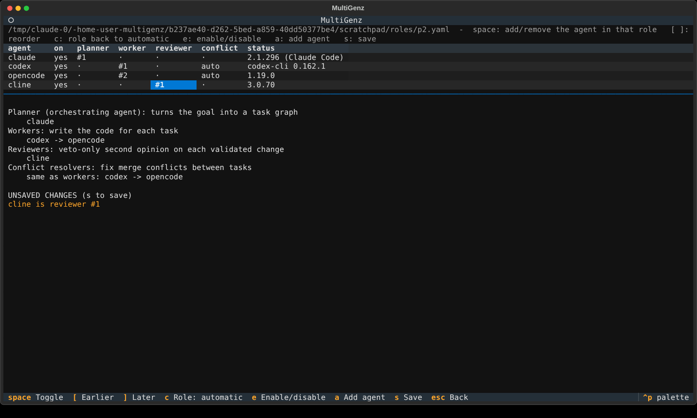
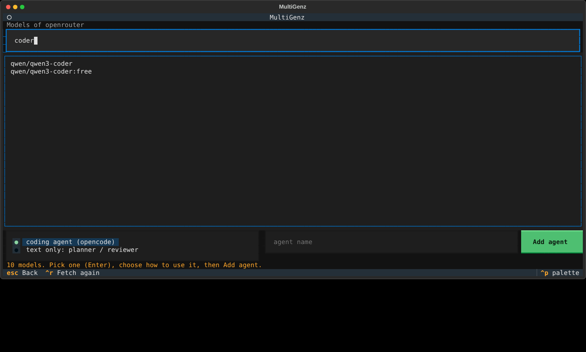

# Operations guide

## Requirements
Linux, Python ≥ 3.12, git ≥ 2.38 (`merge-tree --write-tree`), SQLite with WAL, and one isolation backend:
a rootless `podman`/`docker`, or unprivileged user namespaces plus util-linux `unshare` (the built-in `userns` backend).
`multigenz doctor` checks all of this.

## Policy
The policy YAML is administrator-owned, parsed strictly (unknown keys are errors) and fails closed. Lookup order:
`--policy`, `$MULTIGENZ_POLICY`, `~/.config/multigenz/policy.yaml`, built-in defaults. A run stores a snapshot of the
policy (JSON + sha256) at creation; `runs resume` uses the *snapshot*, so editing the file cannot loosen a running run.

Key rules enforced at load time: `git.auto_push` must be `false`; `git.protect_default_branch` must be `true`;
`execution.isolation: none` additionally requires `allow_unsandboxed: true` (and unattended agent invocations refuse to run
unsandboxed regardless).

### Agents
`adapter: cli` agents run in the sandbox. **No CLI flag is assumed.** An invocation is enabled only when every string in its
`requires_help_tokens` appears in the binary's own help output (`help_args`, default `--help`). Built-in candidates:

| Adapter (by agent name or command basename) | Built-in invocations | Verified with |
|---|---|---|
| `claude` | `--print --permission-mode acceptEdits` / `plan` | real model runs |
| `opencode` | `run --auto` (code) / `run --agent plan` (read-only roles) | real binary + local scripted model, in the sandbox |
| `cline` | `--yolo` (code) / `--plan` (read-only roles) | real binary + local scripted model, in the sandbox |
| `codex` | `exec --sandbox workspace-write` (code) / `exec --sandbox read-only` (read-only roles) | real binary + local scripted model, in the sandbox |
| `hermes` | `-z {prompt}` (one-shot; prompt passed as an argument) | real binary (hermes-agent 0.19) + local scripted model, in the sandbox |
| `antigravity` / `agy` | none: `multigenz agents add agy` writes experimental candidates | help text only |

All of them read the prompt on stdin, except Hermes, which takes it as an argument (`{prompt}`, at most 120 KB). The easy way to configure them is `multigenz init` (all supported CLIs found on
PATH) or `multigenz agents add <preset>`; both validate the result with the real policy loader and keep a `.bak` copy.
`multigenz agents presets` shows each preset's test status and install hint.

**Codex** keeps its own sandbox inside MultiGenz's. That works because MultiGenz runs every agent as an ordinary uid
(1000) in a child user namespace: since Linux 5.12 a process may map uid 0 into a new user namespace only if it held
CAP_SETFCAP, so a capability-less uid 0 could not start Codex's bubblewrap, while uid 1000 can map itself.

**Logins.** Presets hand an agent its own login by name: environment variables (`credentials.env`) and files mounted
**read-only** at the same path under the sandbox home (`credentials.files`, e.g. `~/.codex/auth.json` →
`/home/agent/.codex/auth.json`). Missing ones are skipped. A CLI that wants to rewrite its login file inside the sandbox
(Cline prints `failed to persist selection`) keeps working; if a login token expires, refresh it by running the CLI once on
the host.

**Installs outside /usr.** For npm-installed CLIs the sandbox automatically exposes the `node_modules` root the binary
lives in and the directory of its `#!/usr/bin/env node` interpreter (never a whole prefix such as `~/.local`); for
pip/pipx/uv-installed CLIs (Hermes) the virtualenv and the interpreter prefix its `pyvenv.cfg` names. Anything else goes
in `execution.readonly_paths`.

Any other CLI with a non-interactive mode can be added by hand:
```yaml
agents:
  my-agent:
    adapter: cli
    command: my-agent
    capabilities: [coding, testing]
    invocations:
      - name: exec
        argv: ["{command}", "<flags>"]                   # placeholders: {command} {prompt_file} {task_file} {task_id} {workspace}
        stdin: prompt                                    # or `none` and pass {prompt_file}
        help_args: ["--help"]                            # e.g. ["exec", "--help"] for a subcommand
        requires_help_tokens: ["<each flag used>"]
        modes: [code, conflict]                          # roles: code, conflict, plan, review, analysis
```
The planner needs an agent with the `architecture` capability and a read-only (`plan`) invocation.
`credentials.env` / `credentials.files` grant a *named* host variable/file to *that agent only*; nothing else from the host
environment is ever passed. `adapter: litellm` agents run in-process for planning/review text only and cannot produce commits.

### Roles: who plans, codes, reviews and resolves conflicts
```yaml
roles:
  planner: ["claude", "opencode"]   # turns the goal into a task graph (the orchestrating agent); next = fallback
  worker: ["codex", "opencode"]     # write the code; order = preference, parallel tasks spread over them
  reviewer: ["cline"]               # veto-only second opinion on every validated change (non-empty = review on)
  conflict: []                      # merge-conflict resolution; empty = the workers
```
Every list is ordered: the first usable agent is preferred and the next is the fallback (an agent counts as usable when
it is enabled and has a verified invocation for that role's mode: `plan`, `code`, `review` or `conflict`). An empty
list keeps automatic selection by capability (planner: `architecture` capability; worker: the task's capabilities;
reviewer: off unless `validation.review_with_agent`; conflict: the workers). With `worker` set, tasks never go to
another agent, and the planner is only offered the workers' capabilities. LiteLLM agents may plan or review but cannot
be workers or conflict resolvers. MultiGenz itself still owns every decision; roles only choose which agent is asked.

Edit roles without touching YAML:



- `multigenz` → `/team` (or `ctrl+t`, or `multigenz tui --team`): a grid of agents × roles. `space` adds/removes the
  agent in the role under the cursor, `[`/`]` reorder, `c` puts a role back to automatic, `e` enables/disables an agent,
  `m` changes the agent's model, `a` adds an agent from a preset, `k` opens the API providers, `s` saves. `#1`/`#2` show the order, `auto` who automatic selection would use, `n/a` that the
  agent has no verified invocation for that role.
- `multigenz roles` (show), `multigenz roles set worker codex opencode`, `multigenz roles clear reviewer|all`,
  `multigenz agents enable|disable <name>`.

Both rewrite only the `roles:` block and `enabled:` flags (comments are kept), validate the result with the policy
loader before replacing the file, and keep the previous version as `policy.yaml.bak`.

### Watching a run: the split view
The run dashboard (`/runs` → a run, or the run a goal typed on the home screen starts) shows the task table, the event
log and, between them, a live pane per agent run: coding and conflict attempts, and the planner and reviewer calls.
Panes follow the attempt's `stdout.log`/`stderr.log` as they are written (stderr dimmed; colours kept; logs are redacted
when written and again when shown, including secrets hidden between colour codes). Active runs come first, up to four
panes (1–3 side by side, four as 2 × 2); the remaining room shows the most recently started finished runs with their
final state. More than four agents working at once: the extra ones are counted under the panes and listed in the task
table. `v` toggles the split view; `l` still opens a task's full logs. Planner and reviewer calls are announced as
`agent.call.started` / `agent.call.finished` events (agent, mode; no paths), so they also appear in the event log.

### Models: which model each agent uses
`agents.<name>.model` picks the model. For a CLI agent MultiGenz passes it as `--model <name>` — but only after the
installed binary's own `--help` shows that option for every invocation it will use (Claude Code, Codex, opencode, Cline,
Hermes and agy all list it today). If the help does not show it, the agent is disabled with that reason instead of
quietly running its default model; an administrator-defined invocation can instead place `{model}` in its `argv`.
For an API-provider agent the model is the provider's model id; without a model, a CLI uses its own default.
```bash
multigenz agents model claude                 # show
multigenz agents model claude --list          # choices, asked from the tool: claude --help aliases (fable, opus,
                                              # sonnet), `opencode models`, a provider's /models; others: type a name
multigenz agents model claude opus            # check the CLI accepts a model, then save (policy.yaml.bak kept)
multigenz agents model claude --clear         # back to the CLI's default
```
In the TUI: `/model` (pick an agent, then a model; type any name for CLIs that cannot list theirs),
`/model codex gpt-5-codex` directly, `/model codex default`, or `m` on the Team screen. Only `agents.<name>.model` is
rewritten; the file is validated before it replaces the old one.

### The interactive home screen
`multigenz` with no arguments on a terminal opens the home screen: the pet, the repository goals run in (the git
repository around the current directory; `/repo PATH` changes it), the policy file, standing notes, the planning mode
and the team with each agent's model, the last runs, and a prompt. Once you start, the welcome box keeps only the
essentials (`/status` and `/runs` show the rest). Without a terminal (a pipe, CI), `multigenz` prints its help instead.

- **A goal** (text not starting with `/` or `#`) starts a run exactly like `multigenz run "<goal>" --repo <repo>
  --detach`, with the repository's standing notes appended. Its progress is shown under the messages — spinner, elapsed
  time, tasks done, agents working, a checklist of tasks with the agent on each — and when it ends a summary (integrated
  tasks, branch and commit, failures with reasons, report path) is written and the terminal bell rings. `Ctrl+O` (or
  `/open`) opens the run's dashboard with a live pane per agent. Esc on an empty prompt offers to cancel it.
- **Plan first** (Shift+Tab, or `/plan GOAL`): the planner agent plans read-only (nothing is created or run), the plan
  is shown — tasks, the files each may change, dependencies, capabilities — and a confirmation is asked. Yes starts a
  run with exactly that plan (it is not planned again); no discards it.
- **The prompt:** Enter sends; `\` + Enter or Ctrl+J (Shift+Enter / Alt+Enter where the terminal reports them) adds a
  line; pasted text keeps its lines. `/` opens a command menu (↑/↓ choose, Enter runs, Tab completes, Esc closes);
  arguments are completed too. `@` lists the files of the repository's HEAD (what the agents' worktrees contain). `?`
  lists the shortcuts. ↑/↓ on the first/last line recall earlier lines; history is kept in
  `$MULTIGENZ_HOME/prompt-history.jsonl` (0600, secrets from the environment redacted).
- **Standing notes** (`# text`, `/memory [add TEXT|remove N|clear]`) are kept per repository in
  `~/.config/multigenz/notes/` (0600) — never in the repository — and appended to every goal started from the TUI.
- **Commands:** `/model`, `/team`, `/plan`, `/agents`, `/providers`, `/planning`, `/memory`, `/status`, `/cost`,
  `/runs`, `/open`, `/resume` (continues an interrupted run in the background and follows it; refuses a finished one),
  `/cancel`, `/repo`, `/doctor`, `/init`, `/theme` (remembered in `~/.config/multigenz/tui.json`), `/export [PATH]`
  (messages to a 0600 file, secrets redacted, and the clipboard; default `$MULTIGENZ_HOME/exports/`), `/help`,
  `/clear`, `/quit`. Keys: `Ctrl+O` dashboard, `Ctrl+T` team, `Ctrl+R` runs, `Ctrl+L` clear, `Ctrl+Q` quit.

See [TUI_COMPARISON.md](TUI_COMPARISON.md) for how this compares with Claude Code and what was left out on purpose
(no `!` shell mode: MultiGenz never runs commands typed into its prompt).

### API providers: use any model with an API key
Besides the subscription CLIs, an agent can use a model from an API provider: OpenRouter, OpenAI, Anthropic, DeepSeek,
Groq, Mistral, Together, xAI, Gemini, a local Ollama / LM Studio, or any OpenAI-compatible URL.

In the TUI: `/providers` (or Team screen → `k`) → `n` (add provider: preset, endpoint, key variable, the key itself - hidden) → MultiGenz
fetches the provider's model ids (`GET <endpoint>/models` with the key) → type to filter, Enter to pick → choose
*coding agent* or *text only* → Add agent. Then give the new agent a role on the Team screen. The same from the shell:
```bash
multigenz providers presets
multigenz providers add openrouter            # asks for OPENROUTER_API_KEY (hidden) and stores it
multigenz providers models openrouter -s coder
multigenz providers use openrouter qwen/qwen3-coder --as coder     # or --as text (planner/reviewer only)
multigenz roles set worker openrouter-qwen3-coder
```
```yaml
providers:
  openrouter: {kind: openai-compatible, base_url: "https://openrouter.ai/api/v1", api_key_env: OPENROUTER_API_KEY}
agents:
  openrouter-qwen3-coder: {adapter: cli, command: opencode, provider: openrouter, model: qwen/qwen3-coder,
                           capabilities: [architecture, coding, testing, review]}
  openrouter-planner: {adapter: litellm, provider: openrouter, model: deepseek/deepseek-r1, capabilities: [architecture]}
```
- **Coding agents** (`adapter: cli`, `command: opencode`) need a harness that can edit files and run tests: MultiGenz
  generates opencode's provider configuration for every attempt (mounted read-only in the sandbox) with the key
  referenced as `{env:NAME}`, and hands that one variable to that agent only. opencode must be installed.
- **Text-only agents** (`adapter: litellm`) call the API from the host for planning and reviews; they cannot change files.
- **Keys** never go into the policy. `providers add` and the TUI store them in `~/.config/multigenz/secrets.env`
  (mode 0600); a variable set in the environment overrides the file. Stored keys are redacted from every log, event and
  report. Local servers (Ollama, LM Studio) need no key (`api_key_env: null`); the sandbox reaches them with `network: host`.
- Anthropic's native API (`kind: anthropic`) lists models with `x-api-key`; its coding path uses opencode's Anthropic
  provider and has not been run against the real API in development.



### Planning and usage: one agent first, subagents only when needed
Every agent run uses the agent's plan or API quota, so MultiGenz keeps the number of runs and the work per run small.
`orchestrator.planning` decides how a goal is split (`multigenz roles planning auto|always|never`, the TUI Team
screen's `p` key, or `multigenz run --planning ...` for one run; `multigenz init` writes `auto`):

| mode | what happens | agent runs for a small goal | for a big goal |
|---|---|---|---|
| `auto` | one worker gets the whole goal. It does it itself, or - only when the goal is too big - changes nothing and replies with `{"subtasks": [...]}`; MultiGenz validates that request like a plan and runs each subtask with its own agent (in parallel where independent) | 1 | 1 + one per subtask |
| `always` | a planner agent splits the goal first (the original behaviour) | 2 (plan + code) | 1 + one per task |
| `never` | one worker does the whole goal; requests for subtasks are ignored | 1 | 1 |

A subtask request is untrusted model output: 2 to `orchestrator.max_subtasks` subtasks, unique ids, a valid DAG,
non-overlapping paths for independent subtasks, policy-clean paths and capabilities the workers have. A rejected
request goes back to the agent with the reasons (a charged attempt); a request made together with file changes is
ignored and the changes are validated. The goal task ends as `split` and counts as done once its subtasks succeeded.
In `auto` and `never` the planner role is not used (a worker takes the goal), so the planning model never does the work.

Planning itself is lean: the planner is told to only plan (no code, no commands, open files only when the plan depends on
them, as few tasks as possible), gets the repository's file list in its prompt, has its own shorter timeout
(`orchestrator.plan_timeout_seconds`, default 300, also used for agent reviews) and, for Claude, only read-only tools
(`--tools Read,Glob,Grep`; older Claude versions fall back to plain plan mode). `multigenz run` prints how many agent runs
a goal took (`agent runs: P planning + C coding + R review`).

### Plugins
MultiGenz does not run plugins itself; agents keep their own plugin systems, and the presets mount them read-only into
that agent's sandbox: opencode's `~/.config/opencode/opencode.json` and local plugins in `~/.config/opencode/plugin(s)/`
(npm plugins named in opencode.json are fetched by opencode, which needs `network: host`), and Hermes's
`~/.hermes/config.yaml`, `.env`, `skills/` and `plugins/`. Plugins in a repository (`.opencode/plugin/`) load from the
task's worktree. Plugin code runs inside the agent's sandbox with that agent's permissions only.

### Validation profiles
Fixed argv lists run in the sandbox against an *exported copy* of the exact tree under test (no network, no `.git`).
`validation.default_profile` verifies each task result; `integration_profile` verifies the **merged tree** before it may
enter the integration branch; the integration head is tested once more at the end. A planner may name a profile via
`validation_profile` only if it exists in the policy. With `require_tests: true` and no profile, nothing can be accepted.
A tree with no tests at all fails a pytest profile (exit 5) — give the repository a baseline test.

## Run lifecycle and states
`created → planning → running → succeeded | failed | cancelled` (or `plan_rejected`). Tasks:
`pending → ready → running → validating → succeeded`, with `failed | blocked | cancelled` terminal; there is no
`running → succeeded` edge. A task is `succeeded` only after: clean agent exit, passing validation event for that attempt,
and a merged integration record. Retries: 2 charged attempts by default (`max_task_attempts`), provider failures
(missing binary / auth / sandbox-required) reassign to another compatible agent without charging the task, rate limits use
capped exponential backoff with jitter, interruptions are bounded separately, merge conflicts get one isolated resolution
attempt (`max_conflict_repairs`).

## State layout (`$MULTIGENZ_HOME`, default `~/.local/state/multigenz`, mode 0700)
```
multigenz.db                  SQLite WAL: runs, tasks, attempts, events (append-only, hash-chained), artifacts, integrations
runs/<run>/worktrees/         integration + one worktree per attempt (preserved; never removed)
runs/<run>/attempts/<id>/     logs/ (redacted stdout/stderr), inbox/ (prompt), sandbox/ (transient launcher files)
runs/<run>/tests/             test-profile logs;  report.json / report.md
```
Git branches live in the target repository under `multigenz/run-<id>/`: `integration`, `task-<task>` (first attempt),
`task-<task>.aN` (later attempts), `task-<task>.cN` (conflict resolutions). Each validated task lands on `integration` as
**one commit holding exactly the tested tree**, with `Multigenz-Task/-Attempt/-Candidate` trailers; intermediate attempt
snapshots stay on their own branches. Review or merge `integration` yourself — MultiGenz never pushes.

## Recovery
`multigenz runs resume <id>` acquires the run's file lock, terminates leftover agent process groups (verified by pid +
kernel start time), snapshots any interrupted work in Git, settles half-finished merges by asking Git, resumes tasks that were
mid-validation at validation, and only then schedules new attempts. `multigenz runs audit <id>` replays the event log and
checks sequence, hash chain, transition legality and equality with the stored state.

## Installer and download page
`install.sh` (also served as `/install` by the page in `site/`) installs into a private virtualenv in `~/.multigenz` and
links `~/.local/bin/multigenz`; see `bash install.sh --help` for the overrides (`MULTIGENZ_REF`, `MULTIGENZ_SOURCE`, ...).
It never uses sudo and only appends one `PATH` line to `~/.bashrc`/`~/.zshrc` (skip with `MULTIGENZ_NO_MODIFY_PATH=1`).
To publish the page: enable GitHub Pages with "GitHub Actions" as the source and get `site/`, `install.sh` and
`.github/workflows/pages.yml` onto `main`; the workflow checks that `site/install` equals `install.sh` and deploys.
GitHub Pages for a private repository needs a paid plan, and the installer itself can only fetch a private repository
over SSH, so a public download page in practice means a public repository (or hosting `site/` elsewhere).

## Running with real Claude Code
1. Install and verify the CLI: `claude --version`. Authentication: use an API key (`ANTHROPIC_API_KEY`); it is injected only
   into the sandbox of the agent that lists it under `credentials.env`. (Interactive OAuth login files can be granted with
   `credentials.files`, but they are mounted read-only, so token refresh inside the sandbox will not work, and a refresh
   attempted from the sandbox could invalidate your host login — prefer the token below.)
   **Subscription (Pro/Max), no API key:** run `claude setup-token` on the host, export the token it prints as
   `CLAUDE_CODE_OAUTH_TOKEN` and list that name under `credentials.env`. Subscription usage limits are shared by all
   parallel agents, and whether automated use fits your plan's terms is for you to check. Untested against the live service.
2. Start from `config/policy.claude.example.yaml`. `network: host` is required for the agent to reach the API (name
   resolution is provided read-only from the host); it means the agent has unrestricted network access.
3. Point `validation.profiles` at your repository's real test command. The repository needs at least one test already
   (a pytest/unittest run that collects nothing fails). Use a throwaway repository first.
4. `multigenz doctor --policy P` → `multigenz agents list --policy P` (shows which Claude invocations were verified) →
   `multigenz plan "<goal>" --repo R --policy P` → `multigenz run "<goal>" --repo R --policy P`; watch with `multigenz tui`.
Claude runs unattended with `--permission-mode acceptEdits`: it can edit files in its worktree but not run shell commands,
so it cannot run tests itself — the orchestrator runs the profile and feeds failures back. This path has not been exercised
against the live service in this repository's tests.

## Known planner behaviour
Planners (including real Claude) sometimes add a "review / run the tests" task that changes no files. Such a task can never
be verified and fails with `agent produced no changes`, making the whole run FAILED even though the real work was integrated
and verified. The planner prompt now forbids these tasks; if one still appears, the integration branch holds the good work
(`runs show` lists it) and you can merge that branch yourself.
